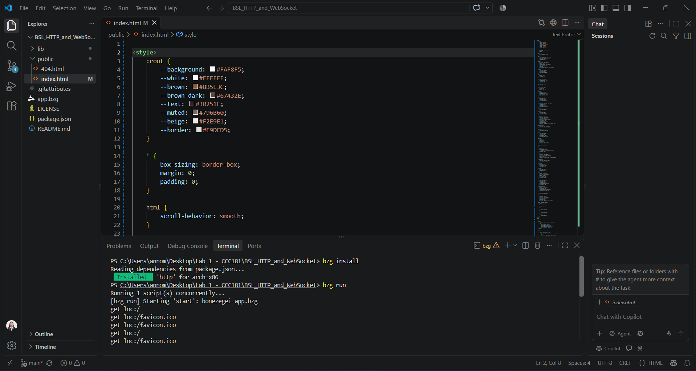
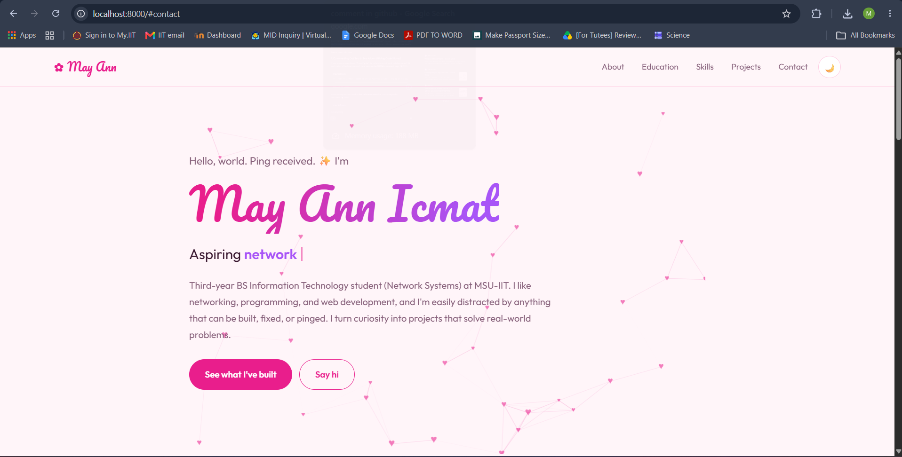

# Personal Portfolio Landing Page

## 1. Project Description

This project is a personal portfolio landing page developed
for CCC181: Application Development and Emerging Technologies.

It introduces the portfolio owner, including their background,
skills, projects, and contact information.

The webpage is written using HTML and CSS and is served locally
through the Bonezegei Scripting Language (BSL) HTTP server.

## 2. Technologies Used

- Bonezegei Scripting Language v1.3.3
- HTML5
- CSS3
- Visual Studio Code
- GitHub

## 3. Project Structure

- `app.bzg` - BSL HTTP server application
- `public/index.html` - Personal portfolio webpage
- `public/404.html` - Page for unrecognized routes
- `package.json` - Project metadata and dependencies
- `LICENSE` - MIT license
- `screenshots/` - Execution verification screenshots

## 4. Setup and Installation

### Prerequisites

- Bonezegei Scripting Language v1.3.3
- Visual Studio Code
- Bonezegei Scripting Language Formatter extension

### Installation Steps

1. Clone or download this repository.
2. Open the project folder in Visual Studio Code.
3. Open the integrated terminal in the project root directory.
4. Install the project dependencies:

   ```bash
   bzg install
   ```

## 5. Running the Application

1. Open the project folder in Visual Studio Code.
2. Open the integrated terminal.
3. Run the application:

   ```bash
   bzg run
   ```

4. Open a web browser.
5. Visit the following address:

   http://localhost:8000

The portfolio should appear in the browser while the server
is running.


## 6. Execution Verification

### Terminal Output

The screenshot below shows the terminal output after running the BSL web server.



### Browser Output

The screenshot below shows the rendered personal portfolio in the browser.



## 7. License

This project includes an MIT License.
See the `LICENSE` file for the license terms.

